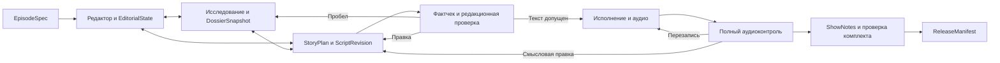
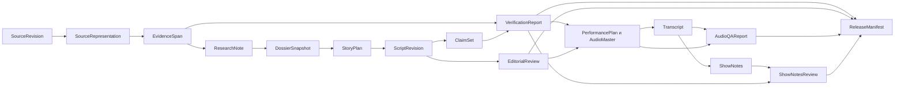

# 00. Архитектура и общий контракт

Спецификация целевой реализации, 4 ноября 2026. Этот документ определяет общие типы и межмодульные правила. Предметные поля принадлежат [01](01-sources-and-evidence.md)–[06](06-platform-and-runtime.md); порядок реализации — [07](07-implementation-plan.md). Существующий код, стек и стоимость разработки не ограничивают проектное решение. Описанные гарантии должны быть подтверждены реализацией и испытаниями, а не самим наличием документа.

## 1. Результат и принцип организации

Пользователь задаёт тему, язык, аудиторию, длительность, формат и предпочтения; исходные материалы необязательны. Система исследует вопрос, выбирает способ объяснения, создаёт целостный сценарий одного или нескольких ведущих, проверяет существенные утверждения и производит естественное аудио с точным транскриптом и источниками. Целевой диапазон — 15–90+ минут; поддержка конкретного языка, формата и длительности объявляется после квалификации, а не из способности объединить много файлов.

Один редакционный владелец ведёт главный вопрос, рабочий ответ, альтернативы, обещание слушателю и причины решений. Это сохранённое состояние и право интеграции, не бессмертный чат модели. Исследование и письмо чередуются; независимые вопросы допускают параллельное исследование. Проверка текста и звука отделена от авторства. Число агентов и способ разделения текста выбираются по качеству полного выпуска, в сравнении с сильной моделью и простыми инструментами.



Каждая стрелка правки создаёт новые версии. Длительность не оправдывает filler, структура claims не диктует драматургию, успешный workflow не подтверждает качество истории.

## 2. Обязательные инварианты

1. Полный смысл сохраняется без молчаливого усечения. Preview — отдельный производный объект; превышение технического лимита возвращает явную ошибку и способ сохранить полный материал.
2. Оригинал, извлечение, точная опора, исследовательская интерпретация, реплика и исполнение — разные сущности. Точное совпадение цитаты не доказывает истинность, причинность или независимость источника.
3. ResearchNote сохраняет связное объяснение с опорами, альтернативами и ограничениями. ClaimSet извлекается из реального сценария; предварительная атомизация всего корпуса не требуется.
4. Код проверяет структуру, доступ, версии, точные диапазоны и вычисления. Модель/эксперт оценивает смысл, достаточность, объяснение и редакционное качество. Заполненное поле не является доказательством качества.
5. Источники, пользовательские документы и прошлые model outputs — недоверенные данные. Они не изменяют права, инструкции и доступные инструменты.
6. Сохраняются все app-controlled входы модели, схемы tools, параметры, фактически отправленный контекст и полученные ответы. Скрытые внутренние рассуждения не запрашиваются; решения имеют краткие проверяемые основания.
7. Изменения не переписывают историю. Допуск относится к точным версиям и отдельному виду проверки; фактчек старого текста не принимает новую реплику или новое аудио.
8. История происхождения не равна действующим смысловым зависимостям. Исправленная версия может выйти из invalidation после явной проверки заменённых/удалённых оснований; старый trace остаётся.
9. ListenerState и первый независимый читатель получают `spoken_view(ScriptRevision)` из 03. Представление сохраняет порядок произносимых реплик и их точные селекторы. Исходный сценарий со всеми редакционными полями сохраняется полностью. ListenerState оценивает предъявленное слушателю. Понимание проверяют слушательские испытания.
10. Ошибка источника/TTS/инструмента не становится выдуманным содержанием, тишиной вместо реплики или фиктивным success. Операционный лимит не означает достаточности исследования.
11. Полномочия проверяются при каждом доступе. Pinned manifest сохраняет входы прошлого запуска, но не предоставляет вечного права читать отозванный материал.
12. Готовность означает точный проверенный комплект текста, звука, транскрипта и show notes. Внешняя публикация — отдельное действие, не следствие ready.

## 3. Единая форма данных

`UUID` — строковый backend-generated UUID; модель не придумывает persistent IDs. `Timestamp` — UTC ISO-8601 с явным `Z`; локальное время используется только для отображения. Поля обязательны; `?` явно разрешает отсутствие поля, а `|null` разрешает значение null, но не пропуск самого поля. Пустой массив означает известное отсутствие элементов; null — неприменимость/отсутствие значения по правилам схемы. Неизвестное нельзя незаметно заменить пустой строкой.

```text
ArtifactRef = {artifact_id: UUID, revision_id: UUID, kind: ArtifactKind}
RuntimeRef = {record_kind: RuntimeRecordKind, record_id: UUID}
BlobRef = {storage_key: string, sha256: string, byte_length: integer, media_type: string}
ProducerRef =
  {kind: model, invocation_id: UUID, profile_ref: ArtifactRef}
  | {kind: code, component: string, build_id: string, operation_id: UUID}
  | {kind: user, actor_id: UUID, command_id: UUID}
  | {kind: human_review, review_session_id: UUID, rater_id: UUID}
ArtifactRevision = {
  ref: ArtifactRef, schema_version: string,
  project_id: UUID, episode_id: UUID|null,
  input_refs: ArtifactRef[], payload: object,
  content_hash: string, producer: ProducerRef, created_at: Timestamp
}
```

artifact_id — идентичность логического объекта, revision_id — неизменяемая редакция. kind проверяется registry и owning schema, а не принимается произвольной строкой. payload хранится inline либо в управляемом blob с точным hash; загрузка полного объекта обязана возвращать весь смысл. BlobRef не даёт доступа к storage без ACL. Хеширование `artifact-jcs-v1`, decimal strings, null/absent и сортировка множеств определены в [06, хранение](06-platform-and-runtime.md#3-canonical-storage).

input_refs фиксирует происхождение артефакта. Оно не является готовым списком вечных смысловых зависимостей; типизированные dependency edges и dispositions определены ниже. RuntimeRef адресует append-only operational запись и никогда не используется вместо EvidenceSpan. Значения `src7@r1`, `u12` в учебных примерах — диагностические aliases, не persistence wire format.

### EpisodeSpec

```text
EpisodeSpec.payload = {
  topic: string, main_question: string|null,
  audience: {description: string, assumed_knowledge: string[]},
  language: string,
  format: solo|dialogue,
  speakers: [{speaker_id: UUID, display_name: string,
              role_description: string, voice_profile_ref: ArtifactRef}],
  duration: {target_seconds: integer, tolerance_seconds: integer, mode: target|strict},
  temporal: {mode: current|historical_as_known|retrospective,
             requested_as_of: Timestamp|null, knowledge_as_of: Timestamp,
             subject_period: {from: string|null, through: string|null}|null},
  source_mode: open_web|supplied_only,
  supplied_inputs: [{input_id: UUID, origin: SuppliedInput}],
  preferences: string[], required_topics: string[], excluded_topics: string[],
  policy_ref: ArtifactRef, source_policy_ref: ArtifactRef,
  delivery: {audio_formats: (mp3|wav)[], transcript_formats: (json|vtt)[]}
}
SuppliedInput = {kind: url, url: string}
  | {kind: upload, upload_id: UUID}
  | {kind: source_revision, source_revision_ref: ArtifactRef}
```

Defaults: 1800 секунд, допуск 120 секунд, mode=target; язык явного запроса/настройки, иначе язык запроса; solo, один квалифицированный stock VoiceProfile; open_web при отсутствии ограничения пользователя; MP3 и JSON/VTT, WAV доступен как export. Defaults показываются и сохраняются. target_seconds>0, 0≤tolerance_seconds<target_seconds; solo имеет одного speaker, dialogue — минимум двух в пределах квалифицированного профиля. Имя/роль ведущего не выдумывает биографию или личный опыт.

Во всех режимах knowledge_as_of равен явно заданному requested_as_of, иначе времени создания spec; будущая граница знания отклоняется. В current requested_as_of по умолчанию null. historical_as_known требует requested_as_of: разрешены сведения, доступные на эту историческую границу. retrospective требует прошлый subject_period, но допускает поздние публикации до knowledge_as_of. subject_period — время рассматриваемых событий, не дата публикации/скачивания; from/through — включённые календарные даты YYYY-MM-DD либо null для неизвестной границы, from≤through при обеих известных. Неизвестная точность даты источника остаётся неопределённостью SourcePolicy. Все дальнейшие `as_of` означают именно `EpisodeSpec.temporal.knowledge_as_of`, если явно не назван другой аспект времени.

knowledge_as_of immutable. Freshness перед release проверяет применимость и corrections; она не подменяет cutoff. Рассказать о текущем состоянии на более поздний момент — новая EpisodeSpec revision с новым временем. Исправление исторической ошибки оценивается отдельно: рассказ о прежних представлениях нельзя незаметно превратить в рассказ о позднем знании.

supplied_inputs — намерение пользователя, поэтому URL/upload можно сохранить до ingestion. Acquisition создаёт отдельные SourceRevision и admissions; EpisodeSpec не дописывается задним числом. supplied_only запрещает произвольный web discovery, но разрешает получение указанных URL/загрузок и их безопасных необходимых ресурсов по SourcePolicy. Внешние ссылки найденной страницы не расширяют список разрешённых источников сами.

source_policy_ref обязан совпасть с source policy выбранного PolicyBundle. Существенная смена вопроса, языка, формата, источников или временной границы — новый spec, а не скрытая редакторская поправка. За пределами duration tolerance требуется исправить выпуск либо получить изменённый spec; strict не обходится filler/неестественным темпом.

## 4. Политики, профили и квалификация

Общий policy_ref адресует `PolicyBundle`: `{source_policy_ref, quality_policy_ref, audio_policy_ref, data_policy_ref, operations_policy_ref}`. Каждый компонент — kind `Policy` с discriminator policy_kind=source|quality|audio|data|operations|evaluation и rules по owning schema. SourcePolicy, AudioPolicy и другие имена в разделах — типизированные представления Policy, не неявные новые kinds. evaluation policy применяется к EvaluationCase отдельно. Непрефиксный policy_ref в InputManifest, AcceptanceRecord, DependencyRevalidationEvent и ReleaseManifest всегда указывает на PolicyBundle; конкретные quality/audio/data rules берутся по точным component refs этого bundle. scoring_policy_ref у EvaluationCase отдельно адресует Policy(evaluation).

`PromptDefinition` сохраняет роль, полный template, placeholders, examples и compiler version. `ToolsetDefinition` — точные schema/description/permissions tools и dispatcher version. `ModelProfile` — immutable configuration провайдера из 06. `ProcessingProfile` хранит profile_kind, implementation/version, configuration и input_profile_refs; profile_kind=extraction|render|recognition|alignment|assembly|delivery|media_decode|calculation|retrieval|context|evaluation. Payload каждого subtype проверяет его владелец. VoiceProfile и PronunciationLexicon принадлежат 05. Одного совпадения kind недостаточно: audio_policy_ref должен адресовать Policy(audio), delivery_profile_ref — ProcessingProfile(delivery).

Профиль не содержит ссылок на будущие capability reports, audition или qualification. Сначала сохраняется candidate configuration; затем CapabilityReport/EvaluationResult/audio samples ссылаются на него; затем отдельный AcceptanceRecord даёт квалификацию точному profile ref и проверенной области применения. Read projection собирает связанные результаты, не изменяя профиль. CapabilityReport из 06 хранит profile_ref, tested_configuration_fingerprint, adapter_version, checks и observed_limits. Наличие параметра API или файла eval не равнозначно разрешению использовать его в production. Первую квалификацию может оформить уполномоченный human evaluator по испытаниям: создание исходного набора qualified profiles не требует уже квалифицированной модели-оценщика.

`EpisodeRun.purpose=production|evaluation`. Evaluation использует pinned EvaluationCase с явным allowlist candidate profiles и отдельными ACL. TaskRun наследует purpose; модель не выбирает его tool argument. Evaluation допускает кандидатов без production qualification, сохраняет ошибки и полноценные outputs, но не создаёт пользовательский ready/release/export. Evaluator-only выдача аудио для слепого прослушивания разрешена. Generation roles не читают скрытые annotations/ratings даже внутри evaluation. Production требует действующей qualification выбранной комбинации языка, роли, формата, длительности и голосов.

### Общий каталог конфигураций

project_id обозначает namespace-владельца; project metadata содержит namespace_kind=tenant|catalog. Тексты, источники, медиа, research и сырые evaluation data разных tenant projects не смешиваются. Единственное allowlisted исключение — exact refs опубликованного read-only catalog: PolicyBundle/Policy/PromptDefinition/ToolsetDefinition/ModelProfile/ProcessingProfile/stock VoiceProfile/публичный PronunciationLexicon. Каталог публикует уполномоченный operator; generation worker не получает такой tool. Отдельно опубликованные nonsensitive audition assets доступны через CatalogPublication.published_assets по правилам раздела 6; полный запрет cross-project media не распространяется на это узкое явное исключение.

ConfigRefResolver проверяет kind/subtype, published revision, права и qualification; это явное исключение к same-project FK, не разрешение любого cross-project ref. Private/custom VoiceProfile и private lexicon остаются project-local и проходят evaluation в том же project. Production runtime проверяет catalog qualification service-side и выдаёт безопасную projection; raw cases, annotations и media результатов не раскрываются модели через traversal каталога. Копировать qualified profile в новый artifact и автоматически переносить approval запрещено.


## 5. Контекст, задания и наблюдаемость

```text
InputManifest = {
  manifest_id: UUID, parent_manifest_id: UUID|null,
  project_id: UUID, task_id: UUID,
  revision_refs: ArtifactRef[], runtime_refs: RuntimeRef[],
  source_scope: SourceScope,
  policy_ref: ArtifactRef, prompt_ref: ArtifactRef,
  toolset_ref: ArtifactRef, model_profile_ref: ArtifactRef
}
SourceScope = {
  mode: open_web|supplied_only, source_policy_ref: ArtifactRef,
  authorized_input_ids: UUID[], authorized_source_refs: ArtifactRef[],
  network_rule_id: string|null, external_processing_rule_id: string
}
TaskSpec = {
  task_id: UUID, role: string, objective: string, why_it_matters: string,
  input_manifest_id: UUID, acceptance_questions: string[],
  allowed_actions: string[], output_kind: ArtifactKind,
  unresolved_context: string[],
  operational_limits: {max_model_calls: integer, max_tool_calls: integer,
                       max_elapsed_seconds: integer}
}
TaskResult = {
  task_id: UUID,
  status: answered|partial|needs_material|unanswerable|failed,
  output_refs: ArtifactRef[], remaining_questions: string[],
  next_action: string|null, failure: Failure|null
}
Failure = {code: string, message: string, retryable: boolean,
           details_ref: ArtifactRef|null}
TaskResultRecord = {result_id: UUID, run_id: UUID, payload: TaskResult}
```

RoleRegistry проверяет role, основной output_kind и разрешённые tools. Связанные вспомогательные artifacts разрешаются контрактами этих tools; worker не может сохранить чужой kind произвольным вызовом. Значения operational_limits положительные, задаются OperationsPolicy; deadline конкретной попытки вычисляется при начале TaskRun, а не навсегда истекает внутри переиспользуемого TaskSpec. Инфраструктурные поля заполняет backend. Модели задаются нормальная задача, полный релевантный контекст и удобные действия, без ручного bookkeeping.

Исходный TaskSpec.input_manifest_id неизменяем. TaskRun хранит ordered chain manifests; каждый ModelInvocation закрепляет один manifest. Tool сохраняет полученный источник/результат; InputAdmissionRecord разрешает включение; следующий invocation использует новый manifest с parent_manifest_id. В 06 у admission отдельно admitted_refs и admitted_runtime_refs. Новое задание на каждый URL не требуется. Расширение scope требует разрешённого решения; содержимое страницы его не заменяет.

Alias registry принадлежит task и хранит typed binding на ArtifactRef либо RuntimeRef. Alias не переназначается; новый ref получает новый alias. DiscoveryHit и поисковый snippet остаются данными append-only SearchRecord/ToolExecution; они могут попасть в manifest.runtime_refs и exact request archive, но не становятся SourceRevision, DerivedPreview оригинала или доказательством. ReadReceipt применяется к artifact reads. Для runtime result ContextAssembly хранит origin RuntimeRef и hash переданного блока; вся реально отправленная выдача есть в request archive. Это сохраняет воспроизводимость без ложного «прочитанного источника».

Read tool создаёт delivery candidate, context compiler записывает ReadReceipt при отправке следующему invocation. При отмене между ними есть prepared/not_sent payload, а не подтверждение доставки. Transport outcome_unknown различает отправку приложением и подтверждение провайдера. Ни receipt, ни admission не доказывают понимания. Схемы admission/receipt/ToolResult/Error и обработка частичных ответов принадлежат [06](06-platform-and-runtime.md).

TaskRun — operational запись с run_id, task_id, attempt, episode_run_id, purpose, generation_epoch, current_manifest_id, checkpoints и status=queued|running|waiting|cancel_requested|cancelled|succeeded|failed. Retry транспорта не создаёт новый logical task. succeeded+partial означает корректно сохранённое неполное исследование; failed требует Failure, остальные semantic statuses имеют failure=null. Отменённый run может не иметь финального TaskResult, но сохраняет checkpoints. Наличие TaskResult не изменяет editorial head: его интегрирует editor через IntegrationEvent/CAS.

### Допуск и отзыв

```text
AcceptanceRecord = {
  record_id: UUID, subject_ref: ArtifactRef,
  check_kind: factual|editorial|audio|show_notes|profile_qualification,
  decision: accepted|changes_required|rejected,
  policy_ref: ArtifactRef, reviewed_input_refs: ArtifactRef[],
  assessment_scope: QualificationScope|null,
  findings: [{report_ref: ArtifactRef, finding_id: UUID}],
  reviewer_ref: ProducerRef, created_at: Timestamp
}
QualificationScope = {
  supported_cells: [{roles: string[], language: string, format: solo|dialogue,
    duration_interval: {min_seconds: integer, max_seconds: integer},
    companion_profile_refs: ArtifactRef[]}]
}
RevocationRecord = {
  revocation_id: UUID, acceptance_record_id: UUID,
  reason_code: string, basis_refs: ArtifactRef[],
  reviewer_ref: ProducerRef, created_at: Timestamp
}
```

assessment_scope обязателен только для profile_qualification, иначе null: остальные проверки привязаны к точному subject целиком. Для текстового subject нужны отдельные factual и editorial records; один accepted не заменяет другой. Полные findings лежат в неизменяемом report, record содержит точные ссылки. Runtime проверяет полномочия, qualification reviewer, отсутствие противоречия между verdict и blocking findings; модель не записывает approval напрямую.

Qualification относится к явно испытанной области применения. Поддержка интервала длительностей требует заранее заданной политики репрезентативных/граничных случаев из 04, а не предположения «короткий пример звучал хорошо». Отзыв append-only, старое решение не удаляется. Policy/source/model drift создаёт impact review: нужно явно определить затронутые допуски, а не переписать историю всех старых выпусков.

## 6. Registry и владение

Один тип имеет одного владельца предметной схемы. Общие registry/envelope находятся в `domain/contracts`; JSON Schema/OpenAPI/tools генерируются из canonical types. Таблицы sources/notes/release_manifests и search indexes — typed projections либо extension rows canonical artifact, не вторые независимо изменяемые копии payload.

| ArtifactKind | Владелец | Основные потребители |
|---|---|---|
| EpisodeSpec, PolicyBundle | 00 / episodes | Все модули |
| Policy | 00 registry; правила 01/04/05/06 | Runtime и соответствующий модуль |
| PromptDefinition, ToolsetDefinition, ModelProfile, CapabilityReport | 06 | ModelGateway, compiler, qualification |
| ProcessingProfile | 00 registry; subtype schema у владельца операции | Extraction, calculations, audio, retrieval, eval |
| SourceRevision, SourceRepresentation, EvidenceSpan | 01 | Research, factcheck, source viewer |
| SourceRelation, SourceFamilyAssessment | 01 | Research, factcheck, source independence |
| DerivedPreview | 06 общий envelope/compiler; semantics у владельца исходника | Context compiler и UI |
| ResearchNote, QuestionRecord, UncertaintyRecord, DossierSnapshot | 02 | Editor, writer, reviewer |
| EditorialState, EditorialDecision, ResearchRequest | 02 | Оркестрация и все предметные handoffs |
| StoryPlan, ScriptRevision, ScriptChangeSet, ListenerState | 03 | Writer/editor, verification, audio |
| ClaimSet, VerificationReport, EditorialReview, CalculationRecord | 04 | Editor, release assembler, source viewer |
| ShowNotes, ShowNotesReview | 04 | Release assembler и UI/export |
| VoiceProfile, PronunciationLexicon, PerformancePlan | 05 | Director, renderer, audio reviewer |
| AudioSegment, AudioMaster, Transcript, AudioQAReport | 05 | Playback, verification, release assembler |
| ReleaseManifest | 00 контракт, 06 запись, 04 правила eligibility | UI/export, evaluator |
| EvaluationCase, EvaluationResult, EvaluationAnnotation, HumanAssessment | 04 | Evaluator-only сервисы и qualification |
| DiagnosticArtifact | 06 | Protected details_ref для ошибок/диагностики |

DerivedPreview.payload={derived_from_ref, text, coverage, compiler_version}; source artifact не ссылается на создаваемый после него preview. EvaluationAnnotation/HumanAssessment содержат полную разметку/оценки из 04 и отдельный ACL. DiagnosticArtifact сохраняет безопасные диагностику/refs без credentials; его содержимое не даёт semantic verdict. Вспомогательные objects вроде StoryOption, ScriptBlock, Claim, Finding и SpokenMapping — вложенные значения owning artifact, не самостоятельные kinds.

Source identity, AcquisitionRecord, SearchRecord, DiscoveryHit, TaskSpec, TaskRun, TaskResultRecord, ModelInvocation, ToolExecution, ContextAssembly, InputManifest, InputAdmissionRecord, ReadReceipt, AcceptanceRecord, RevocationRecord, IntegrationEvent, DependencyRevalidationEvent, CatalogPublication и EpisodeRun — runtime/identity записи, не ArtifactRef. RuntimeRecordKind регистрирует адресуемые append-only записи; минимум search_record, tool_execution, context_assembly, user_input. Изменяемая operational projection не может быть pinned runtime input: нужен сохранённый event/snapshot.

CatalogPublication хранит опубликованный config ref и явно разрешённые published_assets: exact nonsensitive audition BlobRefs/хеши, media metadata и ACL. Только эти assets доступны cross-scope через safe read projection. Это исключение для опубликованных примеров, а не доступ ко всем AudioSegment/EvaluationResult проекта квалификации. Provider secrets, private lexicon и private voice samples не публикуются автоматически.

## 7. Версии, активные зависимости и исправления

У каждого потребителя есть типизированные edges на использованные inputs: uses_content, uses_order, applies_policy, renders, verifies, lineage. Все refs точные. Lineage хранит историю/предыдущую редакцию и не распространяет текущую quality invalidation. Условие применимости source и текущие доступ/удаление проверяются отдельно; политика удаления не сводится к quality graph.

Для model-authored прозы непроверенные фактически показанные содержательные inputs считаются консервативными content dependencies. Автор может предложить replacement/removal в ScriptChangeSet, но не снять её сам. Для code-built контейнеров, например DossierSnapshot, active edges детерминированно строятся из текущих payload refs; предыдущий snapshot — lineage. Удалённая из нового manifest заметка не остаётся active input только из-за истории snapshot.

```text
DependencyDisposition = {
  prior_input_ref: ArtifactRef, current_input_refs: ArtifactRef[],
  disposition: retained|replaced|removed|lineage_only,
  subject_selectors: SubjectSelector[], basis: string
}
DependencyRevalidationEvent = {
  event_id: UUID, subject_ref: ArtifactRef, assessment_ref: ArtifactRef,
  authority: {kind: acceptance_record|integration_event, record_id: UUID},
  dispositions: DependencyDisposition[], expected_validity_version: integer,
  policy_ref: ArtifactRef, created_at: Timestamp
}
```

SubjectSelector — typed union владельцев: ScriptSelector03, NoteSelector02, ShowNotesSelector04, AudioSelector05 либо WholeArtifactSelector={artifact_ref,whole:true}. Селекторы указывают на exact subject. VerificationReport может сохранять собственные affected_selectors/checked_against_script_ref; adapter проверяет равенство subject и нормализует их в событие, а не теряет смысл переименованием полей.

| Subject | Допустимый assessment / authority |
|---|---|
| ScriptRevision | VerificationReport / factual AcceptanceRecord |
| ResearchNote, StoryPlan | EditorialDecision с reviewed_output_refs / IntegrationEvent, принявший эти exact outputs. Для StoryPlan разрешён WholeArtifactSelector всего плана |
| ShowNotes | ShowNotesReview / show_notes AcceptanceRecord |
| AudioSegment/AudioMaster | AudioQAReport соответствующего scope / audio AcceptanceRecord |
| DossierSnapshot и другие code-built manifests | Детерминированная сборка текущих refs; semantic review входных notes выполняется отдельно |

Только принятое owner assessment разрешает append-only revalidation. Projector строит новый effective dependency set; старые edges/trace остаются. removed проверяет отсутствие зависимого утверждения во всём новом subject, включая перефразирование; replaced проверяет новые опоры. EditorialDecision группирует dispositions по subject_ref из reviewed_output_refs. Снятие связи у script не очищает активные зависимости dossier/metadata/audio автоматически. Privacy/access revocation этим событием не отменяется.

Новая SourceRevision сама по себе не делает старую историческую версию ложной. Correction/retraction/ошибка extraction создают pending impact; это требование оценки, а не вечный verdict false для любого использования документа. Старый ошибочный текст может быть корректным evidence того, что раньше было заявлено, если новый claim именно так сформулирован и проверен. Refetch тех же bytes — acquisition/freshness наблюдение, не подмена источника. Если изменена опора, но речь нет, новый factcheck и explicit audio compatibility могут переиспользовать bytes; approvals/refs всё равно новые.

Граф происхождения направлен от прежних/входных revisions к новым результатам. При создании нескольких объектов выбирается порядок без циклов: Decision ссылается на оценённый State@N, State@N+1 — на Decision; Note отвечает Question@N, Question@N+1 ссылается на Note. Script не ссылается на ChangeSet, который описывает эту же Script revision. Report не ссылается на Request, который уже указывает на него, без новой report revision.



Диаграмма показывает основные потребления, не все fields. Исторические parent links и operational acceptance records вынесены из неё. Ни AudioMaster, ни ShowNotes не ссылаются назад на собственные будущие QA/review.


## 8. Редакционный head, bootstrap и состояния

EditorialState/Decision/ResearchRequest определены в 02; ScriptSelector — в 03: `{script_ref, selector:{act_id,block_id,item_id,char_start,char_end}}`. Селекторы Note, ShowNotes и audio ranges определяются своими владельцами. Общий runtime принимает типизированный owner selector, проверяет exact subject и границы; он не угадывает адреса из строк вроде «второй абзац».

ResearchRequest содержит question, why_it_matters, current_understanding, context_refs, acceptance_questions, impact, requested_outcome и blocking=none|passage|central_answer. request указывает на сохранённую версию автора; ответ — TaskResult с полными notes/ограничениями. Новый dossier не вставляет текст в сценарий сам. Editor принимает результат и ставит адресную работу на актуальных входах.

Bootstrap без фиктивного досье:

1. Сохранить EpisodeSpec и выбранные policy/config refs; создать EpisodeRun и EditorialState@0 с main_question из запроса, phase=orienting, dossier/script/plan/working_answer/listener_promise=null, остальными списками пустыми.
2. Source inputs могут ещё загружаться. Runtime показывает их состояние; researcher не получает якобы прочитанные страницы. TaskSpec с пустым initial corpus может разрешать discovery по SourceScope.
3. Создать QuestionRecord от EpisodeSpec и EditorialDecision, указывающее на State@0; State@1 принимает поручение. Первые notes отвечают этим вопросам; dossier создаётся после появления содержательного overview note, а не требует его до исследования.
4. Exploratory ScriptRevision до первого плана или досье допускает соответствующие null refs. Production требует оба. При первом сохранении script change_set_ref=null. Каждое изменение существующей версии создаёт ScriptChangeSet между base и next согласно 03. На первом вызове автор видит, что прежних реплик нет. Сохранённому пустому prefix соответствует null through_item_id.
5. StoryPlan ссылается на предшествующее поручение редактора, затем новый EditorialState принимает план. Ни один объект не ожидает ссылку на собственное будущее принятие.

Обновление досье требует решения о плане. Если принятый P1 ссылается на D1, после появления D2 редактор проверяет, изменились ли ответ, обещание, порядок актов и оговорки. Затем он интегрирует P2 с dossier_ref=D2 через EditorialDecision и IntegrationEvent. Для локальной справки структура P2 может совпадать с P1. Смена центрального объяснения требует пересмотра затронутых актов. Досье доступно исследовательским черновикам сразу. Принятие production-сценария под D2 требует уже принятого плана под D2.

Workers сохраняют результаты независимо. Только editor интегрирует head в транзакции expected_head+generation_epoch: новые artifacts, IntegrationEvent, CAS и outbox. При конфликте proposal остаётся, editor перечитывает текущий head и оценивает перенос; backend не сливает прозу автоматически. Late result не возобновляет cancelled run и не меняет готовый выпуск.

```text
EpisodeRun = {
  episode_run_id: UUID, project_id: UUID, episode_id: UUID,
  episode_spec_ref: ArtifactRef, purpose: production|evaluation,
  evaluation_case_ref: ArtifactRef|null, generation_epoch: integer,
  status: queued|running|waiting|needs_attention|cancel_requested|cancelled|succeeded|failed,
  phase: orienting|researching|planning|drafting|editing|verifying|producing_audio|ready|null,
  editorial_state_ref: ArtifactRef, waiting_reason: string|null,
  failure: Failure|null, checkpoint_refs: ArtifactRef[],
  result_release_ref: ArtifactRef|null, created_at: Timestamp,
  started_at: Timestamp|null, ended_at: Timestamp|null
}
```

phase — проекция принятого EditorialState.phase; status — операционное состояние. Их обновляет один episode event projector, а не независимые решения UI/worker. Обычный ход: queued→running; временное ожидание known dependency/provider даёт waiting→running; успешная production-сборка даёт succeeded с phase=ready. После начала смысловой правки phase возвращается на нужный этап внутри running.

needs_attention означает окончание автоматической работы с конкретным необходимым решением/материалом; failed — техническое завершение; cancelled — подтверждённую отмену. Эти исходы и succeeded терминальны для данной попытки. waiting имеет deadline и не используется для бесконечного ожидания неизвестного ответа. Resume создаёт новый EpisodeRun от выбранного checkpoint; статус завершённого run не переписывается. Изменение EpisodeSpec тоже создаёт новый run и повышает epoch. cancel_requested останавливает назначение работ, затем fencing запрещает late adoption даже если провайдер завершил запрос.

Основной путь проходит через orienting → researching → planning → drafting → editing → verifying → producing_audio. Ориентация может сразу перейти в planning при достаточном досье. Из planning, drafting, editing и verifying разрешён адресный возврат в researching. Новый DossierSnapshot перед продолжением production-письма обрабатывается в planning. Из drafting, editing и verifying разрешён также прямой возврат в planning, если требуется перестройка истории по уже имеющимся материалам. После принятия P2 редактор направляет выпуск из planning в drafting либо editing существующего текста. Проверка исправленного текста снова проходит через verifying. Исполнительский дефект остаётся в producing_audio, смысловая ошибка возвращает выпуск в editing либо researching/planning. ready присваивается после принятия точного комплекта.

`current_ready` — отдельная проекция: production manifest соответствует текущим spec/head, все требуемые допуски действуют, доступ и policy разрешают выдачу. После revocation прежний run остаётся исторически succeeded/phase=ready, но current_ready=false. Для исправления начинается новый run. ready не является дополнительным значением EpisodeRun.status и не означает внешней публикации.

## 9. Точный комплект выпуска

```text
ReleaseManifest.payload = {
  purpose: production|evaluation, evaluation_case_ref: ArtifactRef|null,
  episode_spec_ref: ArtifactRef, dossier_ref: ArtifactRef,
  story_plan_ref: ArtifactRef, script_ref: ArtifactRef,
  verification_report_ref: ArtifactRef, editorial_review_ref: ArtifactRef,
  performance_plan_ref: ArtifactRef, audio_master_ref: ArtifactRef,
  audio_qa_ref: ArtifactRef, transcript_ref: ArtifactRef,
  show_notes_ref: ArtifactRef, show_notes_review_ref: ArtifactRef,
  policy_ref: ArtifactRef
}
```

Для production evaluation_case_ref=null, для evaluation — точный разрешённый case. ClaimSet и ListenerState однозначно доступны через выбранные reports; список segments/voice/lexicon/delivery profiles — через PerformancePlan/AudioMaster. Рекурсивные refs проверяются, а не заменяются на latest. Manifest не содержит собственную mutable eligibility или свой будущий acceptance.

ReleaseAssembler в одной DB-транзакции проверяет expected head/epoch, exact refs, текущие revocations/access, обязательные acceptance kinds и отсутствие unresolved blockers; записывает immutable manifest и operational eligibility event. Синтез, вычисления, LLM и длительные file checks выполняются заранее, их результаты pinned. Принятие отзыва и release commit сериализуются через validity revision/locking: гонка не должна пропустить отозванный input. Changed script или validity revision → conflict и новая проверка.

Перед допуском текста, передачей в TTS и сборкой выпуска применяется одна проверка текущей ветки. Она читает открытые passage/central_answer ResearchRequest из проекции регистраций и принятых редактором решений по 02/06. Удаление placeholder или пропуск ссылки в author sidecar не закрывают запрос. Поздняя регистрация меняет validity_version. Успешная проверка принадлежит точной версии ветки.

При интеграции production-сценария S редактор берёт из текущей ветки принятые EpisodeSpec E, DossierSnapshot D и StoryPlan P. Проверяются `P.episode_spec_ref = D.episode_spec_ref = S.episode_spec_ref = E`, `P.dossier_ref = S.dossier_ref = D` и `S.story_plan_ref = P`. Отчёты создаются после интеграции. При допуске текста оба отчёта указывают на S, а EditorialReview.story_plan_ref совпадает с P. При сборке manifest закрепляет тот же набор E, D, P, S и те же принятые отчёты. PerformancePlan использует этот сценарий и выбранные text reports. AudioMaster, Transcript и master-scope AudioQA согласованы по script/performance/master. ShowNotes и ShowNotesReview проверяют соответствующие audio, transcript, script и VerificationReport. Полная проверка включает production+complete, отсутствие placeholders, квалификацию профилей и измеренную длительность по 04/05.

Evaluation прогоняет тот же assembler для проверки полного пути. Единственное специальное допущение — candidate configurations из EvaluationCase allowlist вместо production qualification. Пройденная сборка может сохранить evaluation-scoped manifest; он не разрешён для пользовательского ready/export. Неуспешные проверки остаются failed/inconclusive EvaluationResult, не маскируются успешным manifest. Evaluator-only выдача artifacts для анализа остаётся доступна.

ShowNotes chapter start_frame и Transcript используют canonical PCM master sample frames из 05, origin=0, `[start,end)`. Playback/export применяет проверенный playback_decode_map; encoder delay не принимается за ноль по умолчанию. После изменения montage строятся новый transcript, chapters и reviews, даже если слова остались прежними.

## 10. Межмодульные handoffs

| Производитель → потребитель | Передаваемый контракт | Что проверяет получатель |
|---|---|---|
| API/06 → editor/02 | Exact EpisodeSpec, PolicyBundle, supplied inputs, initial state | Полный запрос, квалификация комбинации, source/temporal scope |
| 01 → 02/04 | SourceRevision/Representation/EvidenceSpan + original anchors | Разрешимость, версия, контекст, extraction warnings; смысл проверяется отдельно |
| 02 → 03 | Принятые DossierSnapshot и StoryPlan на этом досье, EditorialState, полные notes | Что установлено, какая связка требует исследования, как это меняет план |
| 03/04 → 02 | ResearchRequest с exact requester/typed selector/blocking | Конкретный пробел, scope, impact; ответ интегрируется явно |
| 03 → 04 | Complete script, spoken_view, согласованные plan/dossier, ListenerState, change set при наличии предшественника | Полный claim/coverage audit, независимое чтение реплик, факты и история |
| 04 → 05 | Exact script и действующие factual/editorial acceptance | Отсутствие placeholders, квалификация profiles, совпадение refs |
| 05 → 03/04 | Адресный audio defect/normalization issue/duration | Нужна ли смысловая правка и повторный фактчек |
| 05 → 04/06 | Master, actual Transcript, master AudioQA, profiles | Fidelity, полное покрытие, измеренные сроки, exact binding |
| 04 → 06 | ShowNotes/Review, принятые отчёты и eligibility request | Полный manifest closure, validity/epoch, current access |
| 04/06 → profile consumers | Qualification projection на exact config | Scope квалификации и отзыв; raw gold не выдаётся генерации |

Handoff не состоит из одного summary или списка ID. Обязательные смысловые входы и full read path описаны владельцем; compiler фиксирует реально доставленное. Если контекст не помещается, меняются задача/профиль/явное представление, а не сохранённый смысл.

## 11. Сквозной fixture и проверка исправления

Все числа и учреждения ниже вымышлены; это fixture из 01–04, а не факты о реальном городе.

1. EpisodeSpec задаёт вопрос о причинах изменения транспортного расписания, 30 минут, русский dialogue. Первичный протокол содержит «Тест длился 12 недель»; второй источник содержит 3200 и 4000 поездок. Acquisition/representation/evidence имеют отдельные exact refs.
2. ResearchNote объясняет срок и изменение числа поездок, отдельно отмечает отсутствие причинной оценки. Два зеркала протокола имеют общий SourceFamilyAssessment. TaskResult.partial остаётся полезным результатом и не означает готовности истории.
3. Writer сохраняет draft с «новый график увеличил поездки на 25%». CalculationRecord подтверждает арифметику; VerificationReport отмечает недостаточную опору причинности. Complete script ещё не получает factual acceptance.
4. Editor ставит ResearchRequest на причинный вывод. Новый материал либо обосновывает связь, либо сохраняет её неизвестной. Редактор интегрирует план на обновлённом досье. Автор меняет соответствующие реплики и при необходимости всю структуру. Script@N+1 хранит parent@N как lineage, а новые основания — active content dependencies.
5. Независимая проверка нового полного текста подтверждает, что прежнее причинное утверждение удалено/уточнено, и сохраняет dependency disposition. Runtime закрывает соответствующий pending impact; новый Dossier строит active closure из нынешних notes, не из старого snapshot. История ошибочного draft остаётся воспроизводимой.
6. Новый complete script с двумя text acceptances поступает в PerformancePlan. Если TTS произнёс «двадцать» вместо «двенадцать», audio finding блокирует unit/master. Forced alignment ожидаемого текста не отменяет дефект; требуется корректный retake и новая проверка фактического audio.
7. Master/Transcript/AudioQA и ShowNotes/ShowNotesReview собираются в Manifest@R1. Если после этого меняют отрицание в одной реплике, R1 остаётся историческим комплектом, current_ready для нового намерения false; идут повторные проверки и новый R2.
8. Отзыв доступа к private источнику запрещает дальнейшее чтение/выдачу затронутых данных по policy. Ни lineage_only, ни фактчек не обходят purge. При cancel поздний retake сохраняется диагностически и не создаёт R2.

## 12. Границы реализации и приёмка

Целевой backend модульный: `episodes` владеет намерением/ветками; `evidence`, `research`, `writing`, `verification`, `audio` — предметными алгоритмами; `runtime` — выполнением/контекстом/tools; `persistence` — canonical storage и typed projections. Domain не импортирует SDK/Temporal/HTTP. Стек 06: Python/FastAPI, Temporal, PostgreSQL/pgvector, S3-compatible storage, React/TypeScript, FFmpeg. Выбор модели/голоса/численных порогов проходит эксперименты 04/07.

Общие contracts реализуются один раз, затем из них получаются API/tool schemas и fixtures. Spec изменения требуют owner review, обновления producer/consumer и migration/replay strategy 06. Несовместимая schema не исправляется silent coercion либо обрезкой. Параллельная разработка допустима после фиксации handoff; завершённость определяется полным пользовательским путём.

Обязательные проверки общего контракта:

- Round-trip длинных semantic fields, Unicode selectors и decimal values сохраняет полный смысл; невозможное значение отклоняется явно.
- Bootstrap от URL/upload до первых notes/plan/script не имеет циклических refs и не требует фиктивных содержательных объектов.
- Discovery metadata остаётся runtime data; admission/manifest/receipt воспроизводят реально отправленный контекст без фиктивной цитаты.
- Два worker результата, CAS conflict, повтор tool delivery, unknown provider outcome и cancel не теряют прогресс и не создают duplicate adoption/release.
- Исправление ложного утверждения очищает текущую quality invalidation через проверенное owner disposition, сохраняя lineage; access deletion остаётся действующим.
- Изменение текста, порядка, evidence, voice, montage, policy или qualification не переносит старый approval на несовместимый комплект.
- Старый succeeded run и phase=ready не скрывают current_ready=false после отзыва; resume создаёт новую попытку.
- Candidate profile проходит evaluation без циклов configuration→evaluation→configuration; evaluation artifacts не становятся пользовательским выпуском.
- Catalog configuration/опубликованный audition доступен по allowlist, private source/eval gold/custom voice другого проекта недоступны через тот же resolver.
- Гонка approval revocation/сборка выпуска и Script edit/сборка выпуска дают конфликт либо корректный exact manifest, а не смешанные версии.

Контрактные проверки подтверждают корректность соединения частей. Польза выбранной организации исследования, понятность выпуска и естественность звука подтверждаются полными независимыми оценками 04/05; эти результаты нельзя заменить количеством пройденных схем.
