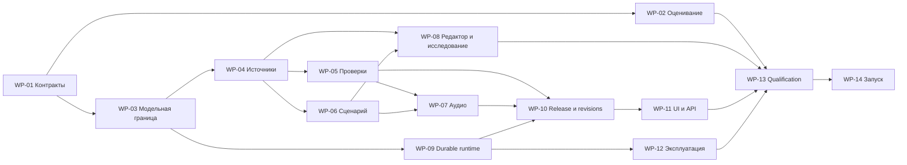

# 07. План полной реализации

Спецификация от 4 ноября 2026 года, сценарные испытания уточнены 5 ноября. План связывает предметные контракты с разработкой, испытаниями и запуском полного продукта. [Общая архитектура](00-system-contract.md) · [Платформа](06-platform-and-runtime.md).

## 1. Что строить сначала

Первый инженерный результат — воспроизводимый полный выпуск, на котором видно, способен ли выбранный способ исследования, письма и исполнения дать нужное качество. Для этого сначала нужны общие контракты, сохранение материалов, журнал фактических модельных входов, оценочный корпус и предметные use cases. Развёртывание большой платформы до получения такого свидетельства не отвечает на главный вопрос проекта.

Ранний запуск использует те же domain types, repositories, model adapters и use cases, которые затем подключаются к durable workflow. `InlineEvaluationExecutor` вызывает общие use cases через те же ports; Temporal позднее меняет адаптер исполнения, а не модельную логику. Это не второй набор бизнес-правил и не одноразовый pipeline. Отсутствие автоматического recovery у inline runner допустимо только внутри явно обозначенного эксперимента; он не обслуживает пользовательские production runs. Полный recovery, интерфейс и эксплуатация входят в обязательное завершение.

### Зафиксированные решения и проверяемые варианты

| Зафиксировано контрактом | Выбирается по экспериментам |
|---|---|
| Полные originals/notes/scripts, версии и точные ссылки | Extraction/retrieval profiles и способы подачи контекста |
| Связное досье, единый редакционный владелец | Число исследовательских вызовов/workers, совмещение ролей |
| Память по написанному тексту и глобальная редактура | Whole-episode или sequential-acts writing, форма ListenerState |
| Независимые фактчек, editorial review и audio QA | Модели проверяющих, организационная степень независимости |
| Точная сборка проверенных версий и честные ошибки | Конкретные LLM/TTS/ASR/voice profiles, numerical quality policies |
| Domain/use-case границы, общий runtime и typed tools | Замена технологического адаптера при измеренном недостатке |

Исходный стек берётся из [06](06-platform-and-runtime.md): Python, PostgreSQL, object storage, Temporal, TypeScript/React, FFmpeg. Решение о технологии пересматривается по конкретной неудовлетворённой функции/проверке; смена библиотеки сама по себе не считается улучшением.

## 2. Этапы и зависимости

| Этап | Обязательный результат | Условие перехода |
|---|---|---|
| M0. Контракт и измерение | Схемы, persistence, corpus, baseline runner, изоляция evaluation | WP-01–03; воспроизводимый input/output и проверка отсутствия утечек annotations |
| M1. Качество полного выпуска | Полный текст и аудио на экспертном досье, одинаково доступном сравниваемым авторам | WP-04–07 в evaluation, результаты EXP-01/02/04/05/06 и решение по редакционному качеству по правилам EXP-04 |
| M2. Самостоятельное производство | Тема → собственное исследование → проверенный сценарий → фактическое аудио | WP-08 и EXP-03/07; same-access baseline, сохранённые все попытки |
| M3. Надёжный пользовательский путь | Durable execution, revision/cancel/resume, точный release, UI и export | WP-09–11; AC-01–16 через реальные API/worker границы |
| M4. Квалификация продукта | Поддержанные комбинации, recovery/deletion/deploy/restore и полный holdout | WP-12–13; AC-17–20, закреплённые policies и profile acceptance |
| M5. Замена и запуск | Новые runs используют выбранную систему; данные и версии не смешиваются | WP-14; проверенный cutover/rollback и выполненный общий критерий завершения |

Этапы — контрольные точки результата, не запрет параллельной работы. WP-09 начинается после общего ядра, пока проверяется качество M1/M2. UI строится по generated contracts и fixtures, затем подключается к настоящим use cases. Production не выпускается после M1 или M2.

Длинный путь содержательного риска: критерии → источник/досье → объяснение → сценарий → реальный звук → слушательская проверка. Длинный путь надёжности: типы/хранение → исполнение → версии/eligibility → пользовательские команды → аварийное восстановление. Оба должны завершиться; ни один не компенсирует провал другого.

## 3. Пакеты реализации

Пути ниже — целевые пути нового кода. Корень backend: `backend/src/podgen/`; UI: `frontend/src/features/`; evaluation: корневой `evals/`. Владельцы контрактов указаны в 00. Каждая работа включает реализацию, осмысленные проверки и сохранённое доказательство приёмки.

### WP-01. Предметное и persistence-ядро

**Зависимости:** согласованный 00. **Где:** `domain/`, `persistence/`, `episodes/`, `contracts/`.

1. Описать canonical schemas и registry: ArtifactRef/RuntimeRef, ArtifactRevision, ProducerRef, EpisodeSpec, configuration artifacts, TaskSpec/Result, AcceptanceRecord, а также payload-схемы всех владельцев 01–05. ResearchNote/DossierSnapshot/StoryPlan/ScriptRevision нужны экспертным fixtures до появления ResearchEngine WP-08. Генерировать model-facing/API схемы из одного владельца; aliases не сохранять вместо refs.
2. Реализовать ArtifactRepository/ObjectStore, полный текст и blobs, scoped FK, миграции, JCS/hash profile, immutable revisions и append-only acceptance/revocation. Пользовательские материалы не получают cross-project references; права не добавляются в конце проекта.
3. Разделить provenance/lineage и active content/order/policy dependencies. Создать bootstrap пустого EditorialState без циклических ссылок. Идентичность, версия и доступность — разные свойства.
4. Подготовить fixtures: длинная ResearchNote, Unicode/emoji/combining marks, decimal values, пустой listener prefix, новый источник внутри manifest chain, исправленный сценарий со старым parent.
5. Реализовать read-only configuration catalog и scope resolver из 00: только опубликованные разрешённые config kinds доступны по exact ref другим проектам. Capability/qualification разрешает backend через безопасную проекцию; raw evaluation results/gold не раскрываются production-модели. Private custom voice/lexicon остаются в своём проекте.

**Выход:** схемы, миграции, repository contract suite, golden fixtures и registry владельцев. **Приёмка:** byte/text round-trip без усечения; одинаковый hash Python/TypeScript; недопустимые refs/длины дают явные ошибки; история не мутирует; исправление источника допускает новую проверенную версию, не вечную invalidity через parent. AC-01/02/03.

### WP-02. Корпус, рубрики и оценочный runner

**Зависимости:** WP-01; сбор материалов и разметка могут идти параллельно. **Где:** `evals/cases/`, `evals/fixtures/`, `evals/runners/`, `evals/scoring/`, `evals/reports/`.

1. Сформировать начальные 36 тем с development/calibration/holdout по [04](04-verification-and-evaluation.md). Развести связанные темы/source families, закрепить snapshots и разрешённый source access. Для каждого case записать ожидаемый смысл ответа, доказательства, ограничения и опасные ошибочные выводы.
2. Создать typed expert import/factory: экспертное досье, экспертный StoryPlan, корректный script и намеренно испорченные варианты. Сначала проверить схемы/refs WP-01; после WP-04 — exact spans и support closure. Только после этого fixtures допускаются к M1. Это отдельные условия эксперимента; generation worker не читает hidden annotations.
3. Реализовать baseline и candidate runner через одни interfaces. Сохранять реальные requests/tools/results, configs, все повторы и failures; исключить незаметный result cache между независимыми повторениями.
4. Сделать evaluator-only выдачу blind текста/аудио, импорт человеческих оценок, adjudication, paired analysis по темам и воспроизводимый EvaluationResult. Источник оценки — явный, model score не подменяет человека.
5. На calibration определить QualityPolicy с поведенческими anchors, primary metrics, допустимыми regressions, practically meaningful differences и обработкой inconclusive. До этого профиль — кандидат.
6. Заказать независимой профессиональной паре автора и редактора сценарии для репрезентативных исследовательских случаев. Дать тот же бриф, досье, StoryPlan, формат, язык и длительность, что модельным авторам. Сохранить черновик и финальную редакцию. Эти тексты доступны только оценщикам. Для всех вариантов подготовить одинаковую нейтральную читку произносимых реплик и проверить её соответствие тексту.

**Выход:** закрытые splits, rubric/policy revisions, baseline results и comparison reports. **Приёмка:** один frozen case повторяется с теми же inputs и новым вызовом модели; annotations недоступны генерации даже через retrieval; failed/needs_attention не исчезают из denominator. AC-17/18.

**Qualification bootstrap:** `EpisodeRun.purpose=evaluation` допускает только candidate profiles из exact EvaluationCase. Все основные invariants сохраняются, но outputs не становятся production-ready и не выдаются пользовательским export. Evaluator-only player/download разрешён отдельным ACL для слепого прослушивания. CapabilityReport, EvaluationResult и `AcceptanceRecord(check_kind=profile_qualification)` создаются отдельно от чистого configuration profile: его payload не переписывается после испытания.

### WP-03. ModelGateway, context compiler и tools

**Зависимости:** WP-01, контракты runner WP-02. **Где:** `runtime/models/`, `runtime/context/`, `runtime/tools/`, versioned prompts предметных модулей.

1. Реализовать provider adapter capability contract, полный request/response archive, refusal/incomplete/outcome_unknown, typed ToolResult и идемпотентные mutations. Начать с candidate profiles сильных моделей, поддерживающих нужные modalities/tools; не закреплять победителя до EXP-01.
2. Скомпилировать TaskSpec → exact ModelInvocation: цель, смысл, полные релевантные материалы, доступ к остальному, schema versions и параметры. DerivedPreview хранить отдельно; недостаток окна — явная причина перепостановки, не обрезание.
3. Реализовать typed aliases, immutable InputManifest chain, admissions и ReadReceipt при фактической отправке. Search metadata сохранять как RuntimeRef/tool output; snippet не превращается в EvidenceSpan.
4. Создать fault provider: malformed args, truncated stream, late response, duplicate tool call, lost submit acknowledgment, unsupported capability. Прогнать каждый transition без реальной модели, затем проверить заявленные capabilities реальными qualification calls.

**Выход:** общий adapter/dispatcher/compiler, версии prompts/tools, fake-provider harness и настоящие traces. **Приёмка:** можно доказать, что именно получила модель; cancel до следующего invocation не создаёт ложный receipt; повтор tool mutation не создаёт второй artifact; unknown outcome не принят как completed. AC-04/05.

### WP-04. Источники, evidence и retrieval

**Зависимости:** WP-01; model tools подключаются через WP-03. **Где:** `evidence/{domain,acquisition,extraction,spans,retrieval,tools}/`, общий retrieval adapter.

1. Реализовать полный ingest HTML/PDF/OCR/dataset/media по 01: originals до extraction, source revisions, representations, exact selectors, original maps, extraction warnings и scoped acquisition.
2. Связать `search_sources/acquire_source/read_source/inspect_evidence/compare_sources` с автоматическим сохранением опор. Проверить чтение длинного раздела с continuation без потери смысла и exact quote resolution с неоднозначными совпадениями.
3. Реализовать source relations/families, временную применимость, correction/retraction/access events; не присваивать домену универсальную истинность. Исторические snapshots не подменять latest.
4. Построить lexical+dense+exact retrieval и индексируемые notes отдельно от originals. Проверить числа, имена, отрицания, таблицы, русский/английский и ACL-filtered search против exhaustive корпусного поиска.

**Выход:** воспроизводимый корпус, extraction/retrieval comparison и usable source viewer API. **Приёмка:** каждый использованный fragment открывается на исходной странице/записи; snippet/summary не становится доказательством; исправление OCR создаёт новую representation; injection/SSRF/cross-project fixtures не обходят scope. AC-06/07. Результат EXP-02 определяет profiles, а не требование любой ценой сохранить выбранную библиотеку.

### WP-05. Независимая проверка текста и критериев

**Зависимости:** WP-01–04; до появления автора используются expert/perturbed scripts. **Где:** `verification/{domain,extraction,factcheck,calculations,editorial,tools}/`, `evals/scoring/`.

1. Реализовать ClaimSet и coverage audit: сначала читать actual script, затем сравнивать с извлечённым; не ограничивать фактчек авторскими citations. Сделать restricted CalculationRecord, temporal/causal/quote/source-family checks.
2. Реализовать независимый EditorialReview целого выпуска в два предъявления. Сначала рецензент получает только произносимые реплики в порядке воспроизведения. Он фиксирует услышанный ответ, первое место потери нити и основания по конкретным репликам. План, ремарки, авторские заметки и источники открываются во втором предъявлении. Первая оценка сохраняется до их показа. Для 90 минут рецензент последовательно проходит весь `spoken_view`, сохраняя порядок окон и места переходов. Затем сопоставляет обещание открытия с серединой и финалом, включая материал между ними.
3. Связать revision → extraction → фактчек → global review → repair request → новая версия → повторная проверка. Отдельно выполнить checked dependency dispositions для removed/replaced/lineage-only inputs.
4. Испытать omission/negation/causal/denominator/attribution defects, ложные citations, «исправили факт, сломали финал» и противоречивые reviews. Сохранить false accepts и false alarms; настроить автоматических judges на calibration, не на holdout.
5. Добавить редакционные fixtures. Механизм объяснён только в сценической ремарке. Вывод о конкретной банкноте автор распространяет на все деньги в экономике. Вступление увлекает выдуманным личным воспоминанием. Исправление одной даты сохраняет удачный возврат к раннему примеру. Для каждого случая сохранить ожидаемое наблюдение слушателя и участок, по которому рецензент различает смысловую ошибку и полезный повтор. [Редакторская практика](03-editorial-practice.md).

Сначала ядро проверки должно пройти AC-08/10 на подготовленных сценариях. Затем в M1 автор WP-06 исправляет текст и проходит повторную проверку по первой части AC-09. Для второй части AC-09 использовать fixture с зарегистрированным блокирующим запросом и решениями редактора. Сквозной опыт с реальной регистрацией запроса, его закрытием и допуском к TTS выполняется после подключения WP-08/10. На выходе остаются VerificationReport, EditorialReview, воспроизводимые findings и измерение пропущенных дефектов по EXP-06.

### WP-06. История, письмо и глобальная редактура

**Зависимости:** WP-01–04; report contracts и review kernel WP-05, а не уже завершённый совместный rewrite loop. **Где:** `writing/{domain,planning,drafting,continuity,revision,context,tools,prompts}/`.

1. При первом `save_script` создать ScriptRevision с пустым parent и вернуть её ref. ScriptChangeSet возникает со второго сохранения, когда известны обе версии. Backend назначает IDs и offsets. Реплики, citations, directions и placeholders сохраняются раздельно.
2. Реализовать сильное прямое написание и отдельный путь через связный исследовательский текст, из которого автор пишет диалог. Для обоих предусмотреть написание выпуска целиком и актами. Автор получает глобальный план, полные нужные notes, фактически написанный текст и возможность открыть весь сценарий. Сравнение проводится по EXP-04. [Редакторская практика](03-editorial-practice.md).
3. Для длинного акта реализовать `append_blocks` завершёнными блоками. Проверить ожидаемые base revision и место продолжения, сохранить блоки атомарно и вернуть новую версию. Повтор одной операции возвращает прежний результат. При несовпадении базы автор читает актуальный хвост перед новой попыткой. Незавершённая реплика остаётся в диагностике. Переполнение выходного окна получает отдельную причину в EvaluationResult.
4. Извлекать ListenerState из произносимого текста и обновлять его после перестановки, разделения или слияния реплик. Если ответ на ResearchRequest изменил основание центральной сцены, редактор интегрирует Dossier D2 и заново собирает StoryPlan на D2. Новый production script закрепляет согласованные plan/dossier refs и проходит обе проверки.
5. До передачи в TTS разрешить каждый зарегистрированный blocking ResearchRequest по решениям редактора. Удаление placeholder и ссылки из следующего ScriptRevision сохраняет блокировку в общей проекции запросов. Редактор может закрыть запрос после независимой проверки, что зависимое утверждение действительно удалено из всего произносимого текста, включая перефразировки и подразумеваемый вывод.
6. Реализовать глобальную правку и повторное холодное чтение. Задание на правку указывает наблюдаемый дефект и места, которые удалось написать хорошо. Для исправления даты проверить саму дату, сохранившийся смысл возврата к ней и дальнейшую причинную цепь. Оценки первого сценарного черновика и финальной версии сохраняются отдельно.

**Выход:** целостные сценарии с явными изменениями/опорами, реальные prefix traces и сравнение writing strategies. **Приёмка:** текст объясняет главный ответ, не теряет ограничения и не повторяет механизм из-за слепого контекста; callback не отклоняется формальным gate; 90-минутный случай не теряет середину; production audio не принимает draft. AC-09/11, EXP-04.

### WP-07. Полное аудио и проверка слышимого

**Зависимости:** WP-01/03/05; source text из WP-06 либо expert fixture. **Где:** `audio/{domain,performance,synthesis,assembly,alignment,quality,application,tools}/`.

1. Реализовать profiles/lexicon/PerformancePlan, typed spoken mappings, scene/render-unit segmentation и capacity checks после всех normalizations/tags. Первые adapter candidates и их актуальные ограничения — в 05; повторно проверить capabilities при закреплении deployment profile.
2. Реализовать полное получение/decode сегментов, contextual rendering, take selection, PCM montage, normalizing/encoding и измеряемую mapping между master frames и playback. Нет silence fallback или таймкодов по числу слов.
3. Использовать сохранённые ASR/alignment для локализации и привязки сценария, с явной uncertainty. Forced alignment не доказывает произнесённое слово. ASR mismatch, TonePerfect и LLM opinions не являются обязательной браковкой или условием человеческого ремонта. Технические проверки обнаруживают повреждённый файл/сигнал; VAD не является детектором бессмыслицы.
4. Реализовать human timestamp → immutable proposal на одно-два предложения с exact parent/range/text/profile и контекстным preview → один approval точного hash и лимитов TTS/ASR → same-voice/settings TTS с одним соседом с доступных сторон → ASR-localization и exact extraction только target → новая immutable master version, delta/frame map и один цельный after-preview каждой замены. Правка proposal отменяет применимость старого approval; другой parent/hash или несовпавшие source bytes отклоняются до submit и вклейки; явная ветка от старой immutable версии допустима. Original сохраняется; исправленное место и обе стороны стыка прослушиваются человеком. Semantic changes возвращаются в WP-05/06; transcript/chapters обновляются по новой временной карте.

**Выход:** целое аудио с версиями/измерениями и работающий локальный ремонт без обязательного аудиорецензента. **Приёмка:** человек может указать пропуск/неверное слово/плохую подачу по времени, согласовать точный proposal и получить исправление с двумя прослушиваемыми стыками. До approval — ноль новых TTS/ASR; stale/revised proposal не разрешает неправильную замену; короткий/длинный replacement корректно сдвигает suffix. Обрыв stream и повреждённый файл выявляются технически. Sound quality профиля и полного выпуска квалифицируется слепым прослушиванием отдельно. AC-12/13, EXP-05. Автоматический детектор «ыыыааа» не обещается без реальных fixtures и оценки ложных тревог.

### WP-08. Редактор и самостоятельное исследование

**Зависимости:** построение — WP-01–04; полный цикл — WP-05–07. **Где:** `research/domain/`, `research/application/`, `research/context/`, `research/agents/`, `research/infrastructure/`.

До редакционного решения M1 доступны диагностические прогоны отдельных исследовательских заданий. Масштабирование оркестрации зависит от результата EXP-04 на экспертном материале.

1. Реализовать orientation, QuestionRecord, связные ResearchNote, UncertaintyRecord и DossierSnapshot. Полный ответ и существенные контрматериалы передаются редактору; preview не подменяет понимание.
2. Реализовать EditorialState/Decision, постановку адресных TaskSpec, принятие результатов, сравнение существенных альтернатив и сохранение причин выбранного направления. Inbox не двигает head автоматически.
3. Подключить ResearchRequest из writing/review с typed selectors и blocking. Результат исследования возвращается как точный новый dossier и полный связный ответ; автор явно решает, как изменить текст.
4. Испытать ранний exploratory draft, последовательное исследование и независимых workers. Пределы calls/revisions сохраняют partial, запускают диагностику реального prompt/payload/tools и меняют причину тупика; они не удостоверяют достаточность.

**Выход:** самостоятельный полный путь от темы до финального evaluation episode, traces причин решений и сравнение с baseline. **Приёмка:** смешанные временные вопросы разделены; counterevidence меняет ответ; поздние результаты не теряют полезное и не переписывают head; отсутствие источника не превращается в «ответа в мире нет». AC-07/09, EXP-03/07.

### WP-09. Durable execution и команды

**Зависимости:** WP-01/03; разработка параллельно WP-04–08, интеграция со всеми предметными use cases. **Где:** `runtime/tasks/`, `runtime/workflows/`, `api/`, `persistence/`.

1. Реализовать commands/outbox/inbox, TaskRun/TaskResult lifecycle, integration ledger, CAS editorial head и generation epoch. EpisodeRun.status, phase и current_ready остаются разными понятиями по 00.
2. Подключить Temporal workflows/activities к тем же use cases. Workflow history хранит control/refs; full prompts/media остаются в repository. Checkpoints доступны между model calls и предметными commits.
3. Реализовать submit/retrieve/reconcile/replacement, lost outcomes, transport retries, cancellation/heartbeats и resume новым run. Поздний ответ после fence хранится диагностически, не становится новым release.
4. Провести crash injection до/после blob commit, outbox delivery, provider completion, editor CAS, report acceptance и release assembly. Replay старых workflow histories входит в deployment checks.

**Выход:** один предметный процесс с устойчивым исполнением, API-команды и fault report. **Приёмка:** после перезапуска нет потерянного подтверждённого текста, двойной интеграции, дублирующего акта или ложного ready; waiting/needs_attention/cancelled честно различаются. AC-05/14/15.

### WP-10. Release, изменения и пригодность версии

**Зависимости:** WP-01/05/07/09; разработка assembler на fixtures начинается раньше готового audio. **Где:** `episodes/`, `verification/release/`, `persistence/` dependency/eligibility projections.

1. Реализовать ShowNotes с источниками/главами по final Transcript и отдельный ShowNotesReview. Chapter start_frame относится к PCM master; playback/export использует mapping 05. Заголовок/описание не получают права добавлять непроверенный факт.
2. Собрать ReleaseManifest с exact refs, включая show_notes_review_ref. В одной транзакции с CAS проверить intent/head/epoch, обязательные approvals, доступность, policy и full bundle consistency.
3. Реализовать source correction/retraction, user script/spec edits, policy/profile revocation и checked dependency dispositions. Отделить lineage от active quality dependency; сохранённая история не мешает принять исправленную версию.
4. Реализовать current_ready отдельно от исторического completed run. Новый intent не выдаёт старый готовый выпуск за обновлённый; text/audio reuse оформляется новыми bindings/проверками, а не изменением прежних refs.

**Выход:** атомарный assembler, revision/revalidation workflow и точный export bundle. **Приёмка:** сценарий@N+1 невозможно собрать с report/audio от N без явных допустимых новых bindings; новый source snapshot не уничтожает корректный исторический выпуск; privacy revoke не снимается semantic disposition. AC-03/10/13/16.

### WP-11. Полный пользовательский интерфейс

**Зависимости:** contracts WP-01, commands WP-09, release WP-10. **Где:** `api/`, `frontend/src/features/{episodes,editor,playback,sources,exports}/`.

1. Создание выпуска: тема, аудитория, язык, формат/голоса, длительность, временные границы и source mode. Defaults видны; выбираются только квалифицированные комбинации. Upload и URL проходят тот же source workflow.
2. Прогресс через восстановимый event stream: этап, ожидание, выполненный результат, причина доработки; без процентов по числу model calls. Cancel и resume работают после обновления страницы и потери соединения.
3. Экран результата: playback, фактический transcript, chapter seek, источники/оговорки, версия, экспорт. Source viewer открывает exact page/time anchor; закрытая информация не раскрывается чужому пользователю.
4. Правка запроса/текста создаёт новую версию с показом последствий и текущей пригодности. Пользователь видит конкретный unresolved вопрос при needs_attention, а не raw prompt или необходимость вручную управлять workers.

**Выход:** весь путь пользователя через реальные API. **Приёмка:** от создания до прослушивания/экспорта не требуется инженерная консоль; восстановление соединения не повторяет mutation; нельзя прослушать старое аудио под видом новой версии. Keyboard/navigation/accessibility и поддержанные browser playback проверены на целых выпусках. AC-15/16/19.

### WP-12. Эксплуатация, изоляция и восстановление

**Зависимости:** WP-01/03/09; финальные испытания на всём комплекте. **Где:** `operations/`, deployment manifests, operational dashboards/runbooks.

1. Развернуть отдельные API/source/model/audio worker pools, provider rate/concurrency controls и наблюдаемость. Настроить секреты/роль migrations, ACL/RLS, безопасный egress, parser/media isolation, encrypted trace access. Базовые проверки прав уже действуют с WP-01.
2. Реализовать deletion/retention workflow для originals, derived text/media, previews/indexes/caches, exports и provider copies; сохранить честное состояние незавершённого purge. После restore tombstones применяются до доступа.
3. Настроить backup/PITR/object version consistency, workflow deployment versioning/replay и reconciliation. Проверить аварийное восстановление с продолжением выпуска, а не только доступностью API.
4. Прогнать конкурирующие длинные episodes, cancel storms, provider outage, исчерпание capacity, malformed media и cross-project attempts. Метрики отдельно показывают reliability и качество продукта.

Для локального ремонта отдельно проверить crash после approval/submit/нового master, idempotent resume, competing edits на одном parent и сохранность original. В журналах различать подготовленный proposal, approval, платный intent, unknown receipt, assembled version и ещё не выполненное прослушивание цельного after-preview с обоими стыками. Отдельный сбой ASR/localization не повторяет TTS; frozen `/1` не переписывается, fresh proposals только contextual `/2`. Подробный runbook — 05 §16/18 и 06 §13.

**Выход:** воспроизводимый deployment, restore/delete/load отчёты и runbooks с наблюдаемыми признаками успеха. **Приёмка:** нет утечки данных, возврата удалённого после backup, orphan accepted release или бесконтрольного восстановления отменённой работы. AC-14/17/20. Initial targets 06 остаются гипотезами до измерения.

### WP-13. Квалификация конечного продукта

**Зависимости:** WP-02 и завершённый WP-04–12 путь. **Где:** `evals/`, configuration catalog, qualification/eligibility services.

1. На development/calibration выбрать profiles и рубрики по EXP-01–07. Зафиксировать версии, decision rules и release policies до закрытого holdout; каждое обязательное сочетание проверяется целиком.
2. Выполнить RU/EN × 15/30/60/90 минут × solo/dialogue target matrix с несколькими темами, трудными источниками и полным audio. Начальные три независимых повтора и 36 тем не объявлять достаточной статистикой; расширить при высокой неопределённости.
3. Сопоставить baseline/candidate, оценки независимых фактчекеров/редакторов и слушателей. В итог входят неполные/failed попытки, critical false passes, понимание, звучание, completion и variability.
4. Выпустить CapabilityReport/EvaluationResult и отдельные profile_qualification AcceptanceRecord с exact assessment_scope. Production получает безопасную catalog projection; скрытые annotations и raw evaluator data не становятся его контекстом.

**Выход:** qualification dossier, опубликованная support matrix, выбранные immutable config refs и перечень непройденных случаев. **Приёмка:** все объявленные комбинации имеют основание; нет observed critical factual/fidelity false passes в suite; выполнены frozen completion/understanding/audio criteria; inconclusive не выдаётся за победу. AC-17/18/19/20.

### WP-14. Cutover и дальнейшие изменения

**Зависимости:** WP-13 и проверенный operational rollback. **Где:** `episodes/`, import/export adapters, deployment/release manifests, `operations/`.

1. Составить реестр существующих пользовательских originals, exports, незавершённых runs и разрешений. Выбрать read-only архив либо валидируемый import в новые схемы; переписать код разрешено, удаление материалов из этого не следует.
2. При import сохранить исходные bytes/metadata/lineage. Старые summaries/claims/approvals считать историческими данными: они не получают нового verified/ready без проверок. Отклонённый import имеет явную причину и сохраняемый оригинал.
3. Перед переключением сохранить исходные exports и recovery checkpoint; новые episodes маршрутизировать на конкретный versioned deployment/profile set. Активный run не смешивает старую и новую orchestration semantics.
4. При regression остановить новые runs проблемного профиля, отозвать его qualification scope и вернуть предыдущую квалифицированную конфигурацию для новых runs. In-flight workflow продолжает закреплённую совместимую версию либо явно отменяется/возобновляется. Историю не переписывать.

**Выход:** import/archive report, cutover record, проверенный rollback и рабочий новый путь. **Приёмка:** пользовательские файлы не потеряны, старое готовое не притворяется новым, rollback не возрождает отозванный источник/profile. Внешняя публикация остаётся отдельной командой; автоматическая рассылка в этот план не входит.

## 4. Эксперименты и правила выбора

Все EXP создают EvaluationCase/Result по 04 и выполняются в evaluation purpose. Меняется один основной фактор за сравнение; взаимодействия проверяются отдельными conditions. Данные, время, цели и возможности source access фиксируются. Необходимо сохранять все попытки и причины исключений. Стоимость/call count/latency показываются диагностически; качество не заменяется ими.

### EXP-01. Модель, постановка и tools

- **Гипотеза:** тупик объясняется конкретной комбинацией задачи, контекста, tools и модели, а не обязательной неспособностью всего подхода.
- **Варианты/вход:** одни scoped вопросы с полным корректным brief и простыми содержательными tools; затем по одному меняются context contract, tool contract и ModelProfile. Дефектные payload используются как диагностические perturbations, не как основной baseline.
- **Измерение:** корректный связный ответ, сохранение полезного partial, подкреплённость, повторные чтения без результата, failure type и точный trace.
- **Решение:** сначала исправить доказанный дефект постановки/доступа; модель менять по улучшению на нескольких вопросах. Не добавлять semantic gate или повышать call limit вместо устранения причины.

### EXP-02. Извлечение и поиск

- **Гипотеза:** нужная опора находится и читается без потери условия, единицы или контекста.
- **Варианты/вход:** extraction/retrieval profiles на одинаковых originals и размеченных evidence ranges; отдельный oracle с прямым exact fragment отличает retrieval failure от понимания.
- **Измерение:** recall нужного раздела, сохранность чисел/отрицаний/таблиц, оригинальные anchors, downstream ответ и ACL-filtered underfill.
- **Решение:** менять конкретный extractor/index/reranker при воспроизводимом провале. Если источник найден, но вывод неверен, работу возвращать в research/context, а не бесконечно менять поиск.

### EXP-03. Организация исследования

- **Гипотеза:** редактор, связные notes и адресные исследовательские возвраты улучшают объяснение относительно простого сильного исследователя.
- **Варианты/вход:** один последовательный исследователь; editor с последовательными заданиями; editor с независимыми workers. Источники/access одинаковы; writer/QA фиксированы.
- **Измерение:** корректный центральный ответ, ограничения/альтернативы, противоречия, полнота полезного досье и качество полного выпуска.
- **Решение:** сохранить дополнительную координацию только там, где она помогает. Если simple flow не хуже по frozen rubric, использовать его внутри тех же contracts; не сохранять swarm ради архитектурной идеи.

### EXP-04. История и длинное письмо

Проверить две разные гипотезы. Первая касается способа построить историю из досье. Вторая касается размера единицы письма и качества переходов в длинном выпуске. Для одной темы зафиксировать бриф, экспертное досье, экспертный StoryPlan, модель, доступ к источникам, язык, ведущих, длительность, правила редакторских правок и финальной проверки. Изменение плана исследуется отдельно. После контроля с экспертным планом повторить сравнение на самостоятельно выбранном плане как самостоятельное условие.

| Сценарный вариант | Как получить сравнимый черновик | Какой вопрос решает сравнение |
|---|---|---|
| A. Сильное прямое написание | Сразу написать лучший возможный диалог по заданному плану | Какого качества можно достичь одним авторским проходом |
| A2. Прямое написание с дополнительной авторской правкой | Написать диалог, затем дать автору ещё один полноценный проход для исправления связности и реплик | Даёт ли B преимущество при сопоставимой дополнительной работе |
| B. Связный текст, затем диалог | Рассказать историю связным исследовательским черновиком, затем переписать её в реплики ведущих с теми же опорами, оговорками и целью | Помогает ли сначала связать объяснение и лишь затем распределять его между ведущими |

B сравнивается с A и A2. Если B опережает только A, преимущество может объясняться вторым проходом. Записать фактические вызовы, объём прочитанного и объём результата. Дополнительная авторская правка A2 выполняется до общего редакторского прохода, который проходят все варианты. В сольном формате отдельно сравнить прямой рассказ и связный черновик с переработкой в сольные реплики, если такая переработка входит в проверяемую гипотезу.

В каждой выполнимой сценарной ячейке отдельно сравнить написание целого выпуска и последовательных актов. Выдать одинаковый глобальный план и доступ к полному материалу. Затем в подходящей ячейке отдельно менять способ передачи памяти о написанном. Если целый текст превысил возможности вывода модели, сохранить ошибку вместимости и учесть попытку в completion. Качество драматургии сравнивается на законченных версиях с отдельной публикацией частоты незавершённых. Для длинного акта проверить восстановление через `append_blocks`, сохранение стыка и отсутствие двойных блоков при повторе.

**Независимый ориентир.** Профессиональный автор и редактор WP-02 работают по тому же брифу, досье и плану. Сохранить их первый полный сценарный черновик и завершённую редакцию. На calibration определить достижимый уровень понимания, развития интереса, точности и качества диалога, а также допустимый разрыв с таким ориентиром. На сравнительных темах человеческие версии получают случайные обозначения наравне с модельными. Исследовательская проза B доступна для разбора процесса. Её первая полноценная диалоговая версия образует сравнимый сценарный черновик.

**Что предъявлять.** Оценивать первые сравнимые сценарные черновики и финальные версии раздельно. Для обеих стадий использовать реальный произносимый текст в одинаковой нейтральной читке с одинаковым назначением голосов, темпом и громкостью. Проверить, что читка сохранила слова. Удалить из предъявления ремарки, служебные пометки, сведения об авторе и плане. Оценщик записывает пересказ, причинную цепь, существенную оговорку и место потери интереса до открытия досье. Разные версии одной темы и её черновик с финалом распределять между разными слушателями при измерении понимания. Художественное исполнение оценивается отдельно в EXP-05.

Нейтральная читка черновика — материал оценочного стенда с доступом для участников исследования. Он берёт фактические произносимые реплики из закреплённой версии и отмечает пропуски в протоколе. Участники слушают эти реплики как они написаны. Для пользовательского TTS, AudioMaster и выпуска действуют допуски WP-05/07/10.

**Две слушательские группы.** Первая слушает весь выпуск и отвечает после финала. Вторая получает реальный выбор остановиться и отмечает место и причину. Для неё сохранять время экспозиции, добровольную остановку, достижение конца и внешнее прерывание. Технический сбой, конец наблюдения и неизвестную причину помечать отдельно. В анализе времени до добровольной остановки фиксировать цензурирование и показывать его причины и численность по вариантам. Суждения о финале получать у слушателей, до него дошедших. Итоговые оценки полного прослушивания и поведение группы свободного выбора публиковать отдельно. [Порядок оценивания](04-verification-and-evaluation.md).

**Решение M1.** До испытаний закрепить минимальный приемлемый уровень, допустимый разрыв с профессиональным ориентиром и способ разбора неопределённых результатов по 04. Если профессиональный контроль проходит, а все модельные способы систематически дают слабую историю даже на экспертном плане и досье, приостановить масштабирование исследовательской оркестрации. Вернуться к способу письма, редактуре, модели и входам, затем проверить их на новых темах. Если слабы и профессиональные версии, проверить выполнимость брифа, качество материалов, нейтральной читки и пригодность рубрики. Переходить от M1 к масштабированию, когда хотя бы один сценарный способ проходит закреплённый порог в проверяемой группе и укладывается в допустимый разрыв с профессиональным ориентиром. Слушатели должны понимать главную мысль и существенные ограничения, а независимая проверка должна подтвердить устранение блокирующих фактических дефектов. Области с недостаточным свидетельством получают результат `inconclusive`.

### EXP-05. Исполнение и слушательское качество

- **Гипотеза:** contextual rendering и измеряемый montage дают естественный диалог с сохранением проверенного текста.
- **Варианты/вход:** одинаковые scripts/voices где возможно; isolated utterances, multi-turn units, сцены в пределах provider capability; локальная замена двух подтверждённых человеком мест Snow из 05 §18. Candidate TTS/ASR/alignment/perceptual profiles исследуются отдельно от разрешения human repair.
- **Измерение:** fidelity, критические токены, произношение, speaker identity, стыки, timing, усталость и полное blind listening. Playback loudness выравнивается для честного сравнения.
- **Решение:** приятный голос с подтверждёнными критическими пропусками не квалифицируется. Локальный retake считается проверенным после прослушивания исправленного места и **обоих** стыков, а не после successful TTS/ASR или низкого WER. Неподходящий стык требует revised proposal/нового согласованного take; плохая сцена не чинится тишиной. Если ни один provider не проходит, менять synthesis/performance подход, не ослаблять fidelity.

### EXP-06. Способность проверяющих найти ошибку

- **Гипотеза:** независимые coverage/fact/editorial/audio checks отличают хороший результат от убедительно оформленного дефектного.
- **Варианты/вход:** blinded корректные и испорченные scripts/audio; потеря отрицания, causal leap, неверный знаменатель, fictitious quote, mirror independence, misplaced caveat, omitted phrase, ложный timestamp. Reviewer не получает тип внесённого дефекта.
- **Измерение:** critical/major recall, false accepts/alarms, omission detection, repair success и новые ошибки после исправления; adjudication по оригиналам и слышимому.
- **Решение:** сначала чинить пропущенный input/tool/context; затем prompt/model/процесс. Высокий средний score не оправдывает critical false pass. Корректные uncertain cases должны проходить, иначе проверяющий просто отклоняет всё.

### EXP-07. Полный автономный выпуск против baseline

- **Гипотеза:** выбранная организация производит лучший конечный подкаст и устойчиво завершает сложные темы.
- **Варианты/вход:** baseline сильная модель с простыми tools и candidate, одинаковые EpisodeSpec/source access и итоговые checks. Expert dossier не выдаётся только одной стороне. Frozen corpus и live-web trials раздельны.
- **Измерение:** все attempt outcomes, factual/narrative/audio quality, completion и разброс по темам/поддержанным комбинациям; paired topic-level analysis по 04.
- **Решение:** принять candidate только по заранее закреплённым улучшениям и regression limits. При равенстве/неопределённости сохранить более простой доказанный способ либо расширить corpus. Провал всей группы длинных русских диалогов запрещает объявлять её поддержанной.

### EXP-08. Авария, изменение и восстановление

- **Гипотеза:** устойчивое исполнение сохраняет тот же смысловой результат и не создаёт ложного готового комплекта.
- **Варианты/вход:** одинаковый scenario без сбоя и с crash/late callback/cancel/source correction/deletion/redeploy/restore в каждой границе commit.
- **Измерение:** persisted data/refs, duplicate adoption, current eligibility, восстановленный state, удалённые copies и видимый пользователю outcome.
- **Решение:** любой смешанный release, потерянный committed artifact или восстановленный отозванный доступ блокирует запуск. Исправляется соответствующая transactional/state boundary, затем повторяется тот же сценарий.

## 5. Матрица сквозной приёмки

Таблица задаёт будущие сквозные испытания. Для каждого AC при реализации сохраняются входные версии, последовательность событий, результаты и наблюдаемый исход. Статус «пройдено» требует воспроизводимого прогона, а для выводов о качестве — материалов независимого редакторского и слушательского оценивания. Ревью спецификации проверяет согласованность этих требований.

| ID | Сценарий | Обязательное доказательство результата | Работы |
|---|---|---|---|
| AC-01 | Длинный смысловой текст и Unicode проходят все границы | Last paragraph/символы сохранены; limit error явный; Python/TS hash и selectors совпадают | 01, 03 |
| AC-02 | Foreign project ref, forged catalog kind и private voice ID | Доступ отклонён; разрешён только published config grant; нельзя узнать чужой payload/metadata | 01, 03, 12 |
| AC-03 | Ошибочная опора удалена в новой версии | Trace/parent сохранены; accepted disposition снимает только current quality dependency; privacy policy остаётся | 01, 05, 10 |
| AC-04 | Новый web hit → источник → page read; отмена до next call | Search metadata остаётся runtime; admission chain точна; receipt только фактически переданного artifact | 03, 04 |
| AC-05 | Потерян provider acknowledgment, duplicate call и поздний ответ | Unknown outcome/reconciliation различимы; один adopted результат; нет повторной mutation | 03, 09 |
| AC-06 | OCR меняет число, таблица теряет единицу, цитата неоднозначна | Original inspection находит проблему; новый span/representation; ложный exact match не принимается за truth | 04, 05 |
| AC-07 | Противоречащие источники, перепечатки, поздняя публикация и новый материал D2 меняют осевую сцену | Сохранены ограничения, происхождение и граница исторически доступного знания. Редактор перестраивает StoryPlan на D2 и проверяет новую связку плана со сценарием | 04, 06, 08 |
| AC-08 | Причинный переход содержится лишь в сценической ремарке, в другой реплике автор перескакивает с одного предмета на экономику целиком | Холодный читатель до показа плана указывает место, где потерял объяснение. Независимый coverage audit выявляет неподкреплённое обобщение, пропущенный переход или отрицание | 05 |
| AC-09 | После исправления даты остаётся хороший callback. В следующей версии автор убирает placeholder и ссылку на зарегистрированный blocking ResearchRequest | Повторные фактчек и холодное чтение сохраняют полезный возврат и проверяют последствия исправления для финала. Проекция зарегистрированных запросов и редакторских решений продолжает блокировать допуск текста и TTS. Редактор вправе закрыть запрос, если проверка всего произносимого текста подтверждает удаление зависимого утверждения, включая перефразировки | 05, 06, 08, 10 |
| AC-10 | Вступление цепляет ложным личным воспоминанием ведущего. Другой вариант честно выражает неизвестное | Неподтверждённый опыт исправлен или удалён, степень уверенности слышна в самой реплике. Независимая проверка пропускает корректный вариант с неопределённостью | 05, 13 |
| AC-11 | 90-минутный русский диалог теряет центр в середине, длинный акт достигает предела одного вывода. Следом автор дробит реплику и переставляет акты | Первый save возвращает ScriptRevision без ChangeSet. Повтор `append_blocks` оставляет один экземпляр каждого блока на ожидаемой базе. Проверяющий проходит весь `spoken_view` по порядку, отдельно сопоставляет обещание открытия, развитие в середине и ответ в финале. Состояние слушателя обновляется после перестановки, а capacity и качество готового текста отражаются раздельно | 06, 08, 13 |
| AC-12 | Человек указывает время слышимого дефекта, затем сдвигает proposal | Показаны одно-два source sentences, exact range и preview; до exact approval нет TTS/ASR. Revised proposal не наследует approval; исправленные слова реально прослушаны; нет silence fallback | 07 |
| AC-13 | В apply подставлен другой parent/hash; replacement другой длины | Нет splice на чужую базу; новая immutable version с точной delta/map, оригинал сохранён, captions/chapters обновлены либо unresolved. Цельный after-preview из нового master содержит оба стыка и исходных соседей; same voice/settings сохранены, tempo correction отсутствует | 07, 10 |
| AC-14 | Crash вокруг upload/commit/outbox/integration/acceptance | Committed результат сохранён, retries идемпотентны, нет broken refs/duplicate acts | 09, 12 |
| AC-15 | Cancel, reconnect UI и явный resume | Epoch блокирует late adoption; UI не повторяет mutation; resume создаёт новый run с честной историей | 09, 11 |
| AC-16 | Правка текста или policy во время release assembly | Смешанный bundle отвергнут; old release исторический, current_ready вычислен для нового intent | 10, 11 |
| AC-17 | Gold annotations/private originals удалены или недоступны | Generation не читает evaluator gold; purge/backup restore не возвращает private copies в prompts/search/export | 02, 12 |
| AC-18 | Прямой диалог, прямой диалог с дополнительной правкой, исследовательский текст с переработкой в диалог и независимый профессиональный ориентир оцениваются вслепую | Зафиксированы одинаковые бриф, досье, план, модель для модельных вариантов и правила правки. Написание целиком и по актам сравнивается отдельно. Отчёт разделяет черновики и финалы, полное прослушивание и свободную остановку, включая причины цензурирования. Все попытки входят в анализ по темам, решение по M1 воспроизводимо | 02, 05, 06, 13 |
| AC-19 | Обычный пользователь создаёт, слушает, правит и экспортирует | Полный workflow без консоли и ручного управления агентами; все объявленные языки/форматы соответствуют qualification | 11, 13 |
| AC-20 | Redeploy, outage, restore и rollback при активных runs | Run закреплён за совместимой версией; доступ/eligibility не ослаблены; восстановление завершает тот же пользовательский intent | 09, 12, 14 |

## 6. Что проверять при изменении компонента

Изменение не переписывает profile/prompt/schema прежних запусков. Сначала создаётся новый кандидат и фиксируется причина; после соответствующего сравнения новая конфигурация публикуется с точным qualification scope. Нельзя менять rubric в том же сравнении так, чтобы скрыть regression.

| Изменение | Обязательная проверка перед принятием |
|---|---|
| Schema/hash/selector/revision semantics | Golden fixtures, migration round-trip, producer/consumer compatibility, AC-01–04/16 |
| Prompt/context/tool contract | EXP-01 на affected role, regression corpus, контрольные полные episodes с тем же остальным stack |
| Research orchestration/model | EXP-03/07, scope/contradiction/partial cases, narrative и completion после интеграции |
| Writer/ListenerState | EXP-04, длинный actual-prefix/reorder case, factcheck и глобальная оценка нового текста |
| Factchecker/judge/rubric | EXP-06, calibration against humans, disclosure нового holdout при подгонке после просмотра старого |
| Extractor/index/reranker | EXP-02, original anchor checks и downstream episodes для затронутых материалов/языков |
| TTS/voice/normalization/ASR/aligner | EXP-05/06, критические токены, стыки/frames и полное listening по affected combinations |
| Runtime/storage/deployment | EXP-08, сохранённые workflow histories, restore/delete/cancel и точная сборка release |

Canary monitoring выявляет model/provider drift и несовместимые capabilities. Сигнал меняет текущую eligibility/qualification только через записанное решение и целевую проверку; история старых EvaluationResult не переписывается. При подтверждённом critical regression профиль блокируется для новых production runs, а affected releases проходят impact review. Не допускается незаметное переключение на неквалифицированный fallback.

## 7. Начало работ и конечный критерий

Первые последовательные действия:

1. Принять версии документов 00–07 как стартовую спецификацию и завести WP/EXP/AC с владельцами результатов. Не начинать перенос старых классов до определения новых interfaces.
2. Создать целевое дерево domain/use cases/adapters и typed contracts WP-01; параллельно собрать development cases/экспертные контроли WP-02.
3. Поднять ArtifactRepository, scoped blob storage, inline evaluation executor и архив модельных вызовов. Первым воспроизводимым запуском проверить постановку/tool contract на одном scoped вопросе; это diagnostic smoke, не доказательство качества всего продукта.
4. Сделать sources, independent review kernel и writer на общих fixtures. Получить и прослушать полный экспертно обеспеченный выпуск, затем сравнить strategies на нескольких темах. Аудио/понимание проверяются уже здесь, а не в конце платформенной разработки.
5. Замкнуть самостоятельное исследование и возвраты из текста. Параллельно подключать durable executor и пользовательский путь; на полный baseline/candidate эксперимент идти с одинаковыми источниками и критериями.
6. Завершить runtime/UI/operations, зафиксировать policies, пройти закрытую qualification matrix, затем выполнить cutover. Если качество не достигнуто, возвращаться к установленной причине, а не объявлять текущую промежуточную стадию продуктом.

**Полный целевой результат этой спецификации** — RU/EN × 15/30/60/90 минут × solo/dialogue с собственным исследованием, понятным сценарием, проверенным фактическим аудио, transcript/show notes, рабочим интерфейсом и восстановлением. Это явно выбранная проектная матрица, а не цитата требований пользователя. Русские длинные выпуски и диалоги проверяются непосредственно; короткие английские случаи их не заменяют. 90+ минут и дополнительные языки требуют отдельной квалификации расширения.

Непрошедшая комбинация остаётся недоступной production по support matrix, но это незавершённая часть данного плана. Её нельзя выключить ради объявления всей цели достигнутой. Изменение самой целевой матрицы — явное продуктовое решение, а не техническая уловка в acceptance.

Работа завершена только когда одновременно выполнены следующие условия:

- Исследовательский/редакторский путь работает автономно в целевой матрице. Обычный выпуск не требует прохождения неподтверждённого автоматического audio judge. Явно вызванный человеком локальный ремонт содержит approval точного proposal и прослушивание места/обоих стыков; эти действия не маскируются под автоматический pass.
- Frozen quality criteria подтверждены полными независимыми проверками текста и прослушивания; выбранный способ обоснован сравнением, все существенные провалы разобраны.
- Прошли AC-01–20 и обязательные suites владельцев 01–06; нет наблюдаемого ложного ready, потерянного committed смысла или смешивания версий.
- Каждая поставляемая версия воспроизводима по artifacts/configs/trace в пределах возможностей провайдера; изменения/отзыв/удаление корректно отражаются в текущей eligibility.
- Есть проверенные cancellation/recovery/deploy/restore/delete/rollback, рабочие dashboards/runbooks и безопасный configuration catalog.
- Пользовательские originals/exports сохранены либо перенесены с верифицированным отчётом; старые approvals не замаскированы под новые.

Итоговый пакет реализации: исходный код модулей и generated contracts, миграции, версионированные конфигурации, корпус/runner/результаты qualification, полный sample release bundle каждой группы испытаний, fault/recovery отчёты, deployment/runbooks и cutover record. Наличие документации, зелёных schema tests или одного красивого demo не заменяет этот комплект.
